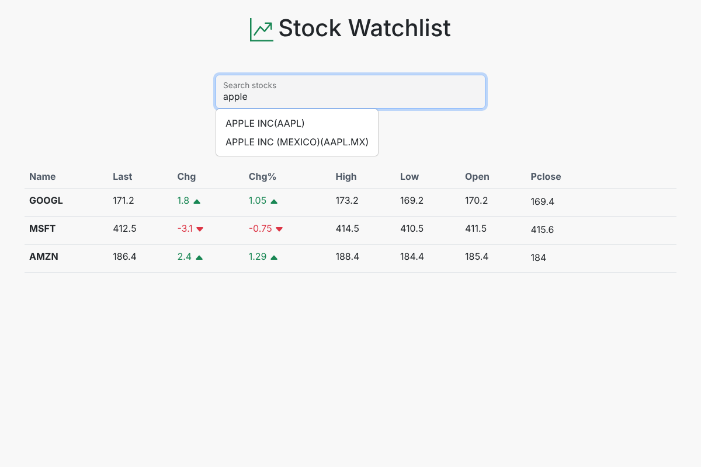
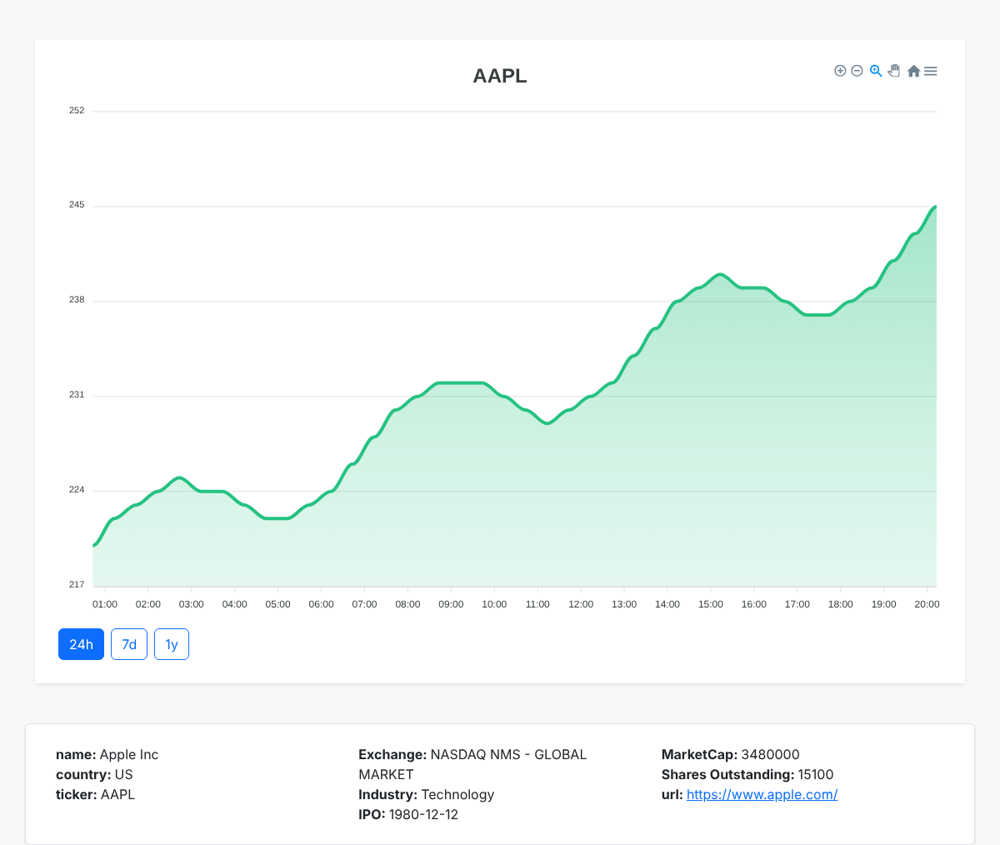

# Stock Trading Watchlist

A React app for following stocks: search for a company, add it to your watch list, see live quotes, and open a detail page with a price chart and company information. Market data comes from the [Finnhub API](https://finnhub.io).

> Originally built in November–December 2022 (on Replit). Reliability fixes, tests and CI were added in October 2026 (see [Changelog](#changelog)).

## Screenshots

*Screenshots use sample data, not live market prices.*

| Watch list and search | Stock detail |
|---|---|
|  |  |

## Features

- Search for stocks by name or symbol (search waits until you stop typing, to save API calls)
- Watch list with last price, change, change %, high, low, open and previous close
- Price up/down shown in green/red with arrows
- Watch list saved in the browser (`localStorage`), so it survives a page reload
- Detail page with a price chart for 24 hours, 7 days and 1 year (ApexCharts)
- Company profile: exchange, industry, IPO date, market cap and website
- Clear error messages when the API key is missing, the rate limit is reached or data is not available

## Tech stack

| Area | Technology |
|---|---|
| UI | React 18, React Router 6, Bootstrap 5 |
| Charts | ApexCharts (`react-apexcharts`) |
| HTTP | Axios |
| Build | Vite |
| Tests | Vitest, React Testing Library, jsdom |
| CI | GitHub Actions |

## How it works

```
StockOverviewPage  (/)
├── AutoComplete ──► GET /search?q=...          add a symbol to the watch list
└── StockList    ──► GET /quote?symbol=...      one request per stock

StockDetailPage    (/detail/:symbol)
├── StockChart   ◄── GET /stock/candle          24h / 7d / 1y price history
└── StockData    ──► GET /stock/profile2        company information

WatchListContext   watch list shared by all pages, saved in localStorage
src/apis/finnHub.js  Axios client; adds the API key from .env to every request
src/utils/stocks.js  data helpers (watch list parsing, chart data, colours)
```

## Getting started

### Prerequisites

- Node.js 18+
- A free Finnhub API key: sign up at [finnhub.io](https://finnhub.io/register) and copy the key from your dashboard

### Setup

```bash
git clone https://github.com/ParnaSaeidpour/Stock-Trading.git
cd Stock-Trading
npm install
cp .env.example .env   # then put your key in VITE_FINNHUB_API_KEY
npm run dev            # http://localhost:5173
```

### Environment variables

| Variable | Purpose |
|---|---|
| `VITE_FINNHUB_API_KEY` | Your Finnhub API key |

`.env` is in `.gitignore`, so your key is never committed.

**Note:** this is a frontend-only app. Vite includes `VITE_*` variables in the JavaScript sent to the browser, so anyone using a deployed version can see the key. Use a free key only. To fully hide a key you would need a small backend that calls Finnhub for the app.

### Free plan limits

- The free Finnhub plan allows about 60 requests per minute. The watch list makes one request per stock.
- Finnhub's price-history endpoint (`/stock/candle`) may not be included in the free plan. If it is not available, the detail page still shows the company information and explains that the chart could not be loaded.

## Scripts

| Command | What it does |
|---|---|
| `npm run dev` | Start the development server |
| `npm test` | Run the tests |
| `npm run build` | Build for production into `dist/` |
| `npm run preview` | Serve the production build locally |

## Tests

```bash
npm test
```

- `src/__tests__/stocks.test.js`: watch list parsing, chart data conversion, chart colour and weekend date handling
- `src/__tests__/components.test.jsx`: the watch list and detail page with the Finnhub API replaced by test data (no API key or network needed). Covers showing quotes, one failing stock, removing a stock, and a detail page whose chart cannot be loaded.

GitHub Actions runs the tests and a production build on every push and pull request.

## Project structure

```
src/
├── apis/finnHub.js          # Axios client for the Finnhub API
├── components/
│   ├── AutoComplete.jsx     # search box with results dropdown
│   ├── StockList.jsx        # watch list table
│   ├── StockChart.jsx       # price chart with 24h / 7d / 1y buttons
│   └── StockData.jsx        # company information
├── context/watchlistContext.jsx
├── pages/
│   ├── StockOverviewPage.jsx
│   └── StockDetailPage.jsx
├── utils/stocks.js          # data helpers
└── __tests__/               # Vitest tests
```

## Changelog

**October 2026**
- Security: the API key is read from `.env` instead of the source code; added `.gitignore` and `.env.example`.
- Fixed: the detail page was blank when the chart data could not be loaded; it now shows company information and a message.
- Fixed: one failing quote request hid the whole watch list; other stocks are now still shown with a warning.
- Fixed: removing every stock and reloading showed an empty row.
- Fixed: search dropdown CSS classes (`dropdown-menu`, `form-floating`) and an API call on every keystroke.
- Fixed: `npm run build` failed (it ran `tsc` without a TypeScript config).
- Fixed: the logo image file was empty; replaced with a title and icon.
- Removed an unused package (`react-icon`), Replit template leftovers and debug logging; development server no longer listens on all network interfaces.
- Updated dependencies within their allowed version ranges (`npm audit fix`). Some development-server warnings remain that need major upgrades (Vite 3 → 8, React Router 6 → 7).
- Added Vitest tests, GitHub Actions CI and a README.

**November–December 2022**
- Original version.
